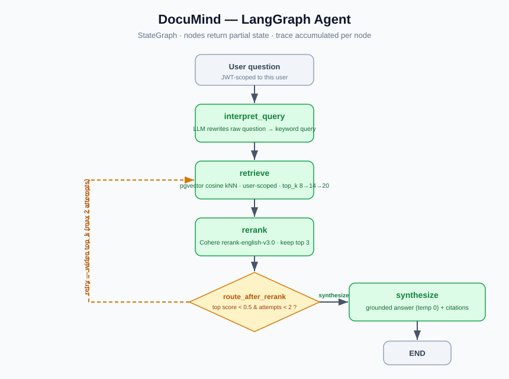

# DocuMind — AI Engineer Interview Guide

> A complete reference for explaining the DocuMind project in an interview.
> Contains: (1) a 30-second pitch, (2) an interview-style narrative, (3) an
> extended technical deep-dive, (4) a one-page cheat sheet, (5) the agent-graph
> diagram, and (6) mock Q&A with likely follow-ups.

---

## Table of Contents

1. [30-Second Pitch](#1-30-second-pitch)
2. [Interview-Style Explanation](#2-interview-style-explanation)
3. [Extended Technical Deep-Dive](#3-extended-technical-deep-dive)
4. [One-Page Cheat Sheet](#4-one-page-cheat-sheet)
5. [Agent Graph Diagram](#5-agent-graph-diagram)
6. [Mock Interview Q&A](#6-mock-interview-qa)
7. [Known Gaps / "What I'd Improve"](#7-known-gaps--what-id-improve)
8. [RAGAS Metrics — How to Interpret Scores](#8-ragas-metrics--how-to-interpret-scores)
9. [Live Demo Script](#9-live-demo-script)

---

## 1. 30-Second Pitch

DocuMind is a **multi-tenant RAG application for Q&A over technical documentation**.
Users upload docs (PDF / Markdown / HTML); the system parses, chunks, embeds, and
stores them; then they ask natural-language questions.

The differentiator is the answer engine: it's not a linear RAG chain, it's an
**agentic pipeline built on LangGraph** that interprets the query, does two-stage
retrieval (vector search + cross-encoder rerank), and **conditionally retries
retrieval with a wider net** when confidence is low — before synthesizing a
grounded, cited answer. Every step emits a trace the UI renders, so the pipeline
is fully transparent.

**Architecture at a glance:**


**One-sentence opener:**
> "DocuMind is a multi-tenant RAG system over technical docs, but the piece I'm
> proudest of is that the answer engine is a real LangGraph agent — it interprets
> the query, does two-stage retrieval, and loops back to retry retrieval with a
> wider net when the reranker's confidence is low, all bounded and traced."

---

## 2. Interview-Style Explanation

### The problem

Technical documentation is painful to search. Keyword search misses paraphrases,
and dumping a whole doc into an LLM is expensive and imprecise. DocuMind lets a
user upload their own docs and ask questions in natural language, getting back a
grounded answer with citations back to the exact source section.

### How I built it (prototype → finished)

I'd tell this as a phased story, because it shows engineering judgment:

1. **Skeleton & contracts** — FastAPI app, three routers (`/auth`, `/documents`,
   `/query`), Pydantic schemas kept separate from the DB models, Postgres +
   pgvector as the datastore, JWT auth from day one because it's multi-tenant.
2. **Ingestion pipeline** — parse → chunk → embed → store, run synchronously in
   the upload endpoint (fine for MVP file sizes).
3. **Baseline RAG** — vector-only cosine retrieval straight into the LLM.
4. **Make it agentic** — wrapped the flow in a LangGraph state machine, added a
   query-interpretation node, a Cohere rerank stage, and a conditional retrieval
   retry loop. *This is the heart of the project.*
5. **Grounding & transparency** — strict grounding prompt, inline citations,
   per-node execution trace returned to the UI.
6. **Evaluation** — a reproducible RAGAS harness (faithfulness, answer relevancy,
   context precision, context recall), split into two phases to dodge a
   dependency conflict.

### The agent (lead with this)

The answer engine is a **LangGraph `StateGraph`** with four nodes —
`interpret_query → retrieve → rerank → synthesize` — plus a **conditional edge
after rerank** that can loop back to `retrieve`.

- **interpret_query**: an LLM rewrites the raw question into a keyword-rich search
  query. The question a human asks and the string that searches best aren't the
  same thing.
- **retrieve**: embeds the query and runs a pgvector cosine kNN search **scoped to
  the user's own documents** (that's where tenant isolation lives). Starts at
  `top_k = 8`.
- **rerank**: Cohere's cross-encoder rescoring, keeping the **top 3**. Classic
  two-stage design — vector search for recall, reranker for precision.
- **route_after_rerank**: if the best reranked chunk scores below **0.5** and we
  haven't hit the **2-attempt cap**, loop back to retrieve with a **wider**
  `top_k` (8 → 14 → 20); otherwise synthesize.
- **synthesize**: strict grounding prompt ("answer ONLY from context, say so if
  it isn't there"), returns the answer plus structured citations.

The two judgment calls I'd emphasize: the loop is **bounded** (an unbounded agent
loop just burns API calls), and the retry **does something different** (widening
`top_k`, not re-running the same query).

### Storage

Everything's in **PostgreSQL + pgvector** — no separate vector DB. Embeddings live
in-row on the `chunks` table. One datastore, transactional consistency between a
doc and its chunks, no extra infra. Trade-off: it won't beat a dedicated vector DB
at huge scale, which I'd acknowledge up front.

---

## 3. Extended Technical Deep-Dive

### 3.1 System architecture

Backend is a FastAPI app under `backend/app/`, organized in clean layers:

| Layer | Path | Responsibility |
|---|---|---|
| API | `api/` | HTTP routers: `auth`, `documents`, `query` |
| Agents | `agents/` | The LangGraph pipeline (AI core) |
| Ingestion | `ingestion/` | parse → chunk → embed |
| Core | `core/` | config, LLM client, security, DI deps |
| DB | `db/` | SQLAlchemy models, session, init |
| Eval | `eval/` | RAGAS evaluation (two-phase) |
| Schemas | `schemas.py` | Pydantic request/response DTOs |

`main.py` builds the app, enables INFO logging, adds CORS (allowing the Vite
frontend at `http://localhost:5173`), mounts the three routers, and exposes
`/health`.

The API contract (`schemas.py`) keeps request/response shapes separate from the
ORM models on purpose — storage shape and API shape are allowed to diverge. The
`AskResponse` carries `{question, answer, citations[], trace[]}`, so the trace is a
first-class part of the response.

### 3.2 Agent architecture (full detail)

**Framework:** LangGraph ≥ 1.2. Defined in `agents/graph.py`.

**Shared state** — one `TypedDict` passed between all nodes:

```python
class AgentState(TypedDict):
    question: str
    user_id: str
    interpreted_query: Optional[str]
    retrieved_chunks: Optional[List[dict]]
    reranked_chunks: Optional[List[dict]]
    retrieval_attempts: int
    answer: Optional[str]
    citations: Optional[List[dict]]
    trace: List[dict]   # one entry per node: {stage, summary, detail}
```

**LangGraph idiom to mention:** nodes don't mutate state in place — each returns a
*partial dict* that LangGraph merges. That's why `trace` is accumulated with
`state.get("trace", []) + [entry]` in every node.

**Graph construction** (`build_graph()`):

```python
graph.set_entry_point("interpret_query")
graph.add_edge("interpret_query", "retrieve")
graph.add_edge("retrieve", "rerank")
graph.add_conditional_edges(
    "rerank",
    route_after_rerank,
    {"retry": "retrieve", "synthesize": "synthesize"},
)
graph.add_edge("synthesize", END)
```

The graph is **compiled once per process** (`_graph = build_graph()` in
`api/query.py`) because LangGraph graphs are stateless and reusable. At startup it
logs its own ASCII diagram via `app.get_graph().draw_ascii()` (needs the
`grandalf` dependency).

**The conditional loop:**

```python
MAX_RETRIEVAL_ATTEMPTS = 2
RERANK_CONFIDENCE_THRESHOLD = 0.5

def route_after_rerank(state):
    reranked = state.get("reranked_chunks") or []
    attempts = state.get("retrieval_attempts", 0)
    top_score = max((c.get("relevance_score", 0) for c in reranked), default=0)
    if not reranked or (top_score < 0.5 and attempts < MAX_RETRIEVAL_ATTEMPTS):
        return "retry"
    return "synthesize"
```

On the retriever side, `top_k` widens per attempt:

```python
BASE_TOP_K = 8
WIDEN_PER_ATTEMPT = 6
top_k = BASE_TOP_K + (attempts * WIDEN_PER_ATTEMPT)   # 8 -> 14 -> 20
```

**Per-node summary:**

| Node | File | Input → Output | What it does |
|---|---|---|---|
| interpret_query | `query_interpreter.py` | `question` → `interpreted_query` | LLM rewrites into keyword-rich query |
| retrieve | `retriever.py` | `interpreted_query` → `retrieved_chunks` | pgvector cosine kNN, user-scoped, widening top_k |
| rerank | `reranker.py` | `retrieved_chunks` → `reranked_chunks` | Cohere `rerank-english-v3.0`, keep top 3 |
| synthesize | `synthesizer.py` | `reranked_chunks` → `answer`, `citations` | Grounded LLM answer with citations |

The retriever enforces **multi-tenant isolation** with
`.filter(Document.owner_id == user_id)` — a user can only ever retrieve from their
own documents.

### 3.3 RAG & ingestion

**Parsing** (`ingestion/parser.py`):
- **Markdown**: reads file, resolves FastAPI-style `{* path/to/file.py *}` snippet
  macros by inlining the referenced Python source *before* chunking ("resolve-
  then-chunk"), so code and its explanation stay in the same chunk. Missing files
  become visible `[code omitted: ...]` placeholders, never silent drops.
- **HTML**: BeautifulSoup, strips `script/style/nav/footer`, extracts text.
- **PDF**: pypdf, concatenates per-page `extract_text()`.

**Chunking** (`ingestion/chunker.py`):
- `MAX_CHUNK_CHARS = 1800`, `OVERLAP_CHARS = 200`.
- **Structure-aware for Markdown/HTML**: split on H1–H3 headers so a chunk never
  straddles unrelated sections, and the header becomes citation metadata. A guard
  (`_real_header_matches`) ignores `#` lines inside fenced code blocks so a bash
  comment isn't mistaken for a heading.
- **Fixed-size + overlap fallback** for PDF (no structure after extraction) and
  for any header section still over 1800 chars.

**Why those numbers:**
- `1800` chars — big enough to hold a full API-reference section (answer stays
  whole), small enough to keep retrieval precise and fit reranker/LLM context.
- `200`-char overlap — preserves continuity across boundaries so an answer
  spanning a split isn't cut in half.

**Embedding** (`ingestion/embedder.py`): provider-switchable like the LLM client.
Active provider `groq` routes to **VoyageAI `voyage-4-lite`**, output-dimension-
matched to the pgvector column so provider swaps never need a schema migration.
Commented-out OpenAI (`text-embedding-3-small`) and Gemini
(`gemini-embedding-001`) implementations remain for easy switching.

**Retrieval** is vector-only (cosine) kNN — not hybrid keyword+vector — followed
by cross-encoder reranking. The two-stage split is deliberate: cheap wide recall,
then expensive accurate precision on a small candidate set.

### 3.4 LLM & embeddings config

`core/llm_client.py` `get_llm()` returns a LangChain chat model (drops straight
into LangGraph nodes), switching on `settings.llm_provider`:

| Provider | Model | Notes |
|---|---|---|
| groq (active) | `groq/compound` | via `langchain-groq` |
| gemini | `gemini-3.5-flash` | via `langchain-google-genai` |
| openai | `gpt-4o-mini` | via `langchain-openai` |

All at **temperature 0** for determinism. Nodes never import a provider SDK
directly — swapping providers = editing only `llm_client.py` / `embedder.py`.

Config (`core/config.py`) is loaded from `.env` via `pydantic-settings`, cached
with `lru_cache`. `embedding_dim = 512` in code matches the pgvector
`Vector(512)` column.

### 3.5 Data storage

**PostgreSQL + pgvector**, embeddings stored in-row. `DATABASE_URL` uses the
psycopg3 driver. `db/init_db.py` is idempotent:
`CREATE EXTENSION IF NOT EXISTS vector;` then `Base.metadata.create_all(engine)`.

Four tables (`db/models.py`):

| Table | Key columns |
|---|---|
| `users` | id (UUID), email (unique), hashed_password, created_at |
| `documents` | id, owner_id (FK), filename, doc_type, created_at |
| `chunks` | id, document_id (FK), content, **embedding Vector(512)**, section |
| `query_logs` | id, user_id, question, answer, created_at |

The `chunks` table *is* the vector store. Retrieval uses pgvector's
`cosine_distance`. No ANN index (IVFFlat/HNSW) yet — exact NN scan, fine for MVP.

### 3.6 Evaluation (RAGAS, two-phase)

Metrics: **faithfulness, answer relevancy, context precision, context recall**,
against a hand-written `EVAL_SET` with ground-truth references.

Two phases in two separate virtualenvs because RAGAS pulls an old
`langchain-community` needing `langchain-core <1`, which conflicts with LangGraph
needing `langchain-core >=1.4`:

- **Phase 1 — `collect.py`** (app venv): invokes the real agent graph for every
  eval question, writes plain JSON (no LangChain objects).
- **Phase 2 — `score.py`** (RAGAS-only venv, zero `app` imports): reads the JSON,
  builds a RAGAS `EvaluationDataset`, scores it. Judge LLM is Groq
  `llama-3.3-70b-versatile`, passed explicitly so RAGAS doesn't default to an
  OpenAI judge. `answer_relevancy` also needs an embeddings model, supplied via
  VoyageAI.

Splitting generation from scoring sidesteps the conflict and is cleaner anyway —
"produce answers" and "grade answers" needn't share a dependency tree.

### 3.7 Auth & security

Stateless **JWT bearer auth**. Passwords hashed with bcrypt (passlib); tokens
issued with python-jose (HS256), 24h expiry, payload `{sub: user_id, exp}`.
`core/deps.py get_current_user` is an `HTTPBearer` dependency that decodes the
token and 401s on invalid/expired/missing user. Every documents/query endpoint
depends on it, and tenant isolation is enforced by filtering on the current user
in every query.

### 3.8 Deployment

Dockerfile: `python:3.11-slim`, `pip install .` from pyproject, runs
`uvicorn app.main:app --host 0.0.0.0 --port 8000 --reload`. docker-compose adds a
`db` service (hostname `db`). Frontend is a Vite app on `:5173`.

---

## 4. One-Page Cheat Sheet

```
PROJECT     DocuMind — multi-tenant RAG Q&A over technical docs (FastAPI corpus)
STACK       Python 3.11 · FastAPI · LangGraph · Postgres+pgvector · Docker · Vite FE

AGENT (LangGraph StateGraph)
  interpret_query → retrieve → rerank → [route] → synthesize → END
                        ^__________________|   (retry, wider top_k)
  State: TypedDict, nodes return partial dicts (merged), trace accumulated per node
  Loop:  retry if top rerank score < 0.5 AND attempts < 2
  top_k: 8 → 14 → 20  (BASE 8 + 6/attempt)

RETRIEVAL   Two-stage: pgvector cosine kNN (recall) → Cohere rerank-english-v3.0 (precision, top 3)
            User-scoped: filter Document.owner_id == user_id

MODELS      LLM     groq/compound (pluggable: gemini-3.5-flash, gpt-4o-mini), temp=0
            Embed   VoyageAI voyage-4-lite (pluggable: text-embedding-3-small, gemini-embedding-001)
            Rerank  Cohere rerank-english-v3.0
            Judge   Groq llama-3.3-70b-versatile (eval only)

CHUNKING    1800 chars max, 200 overlap
            MD/HTML → split on H1-H3 headers (code-fence-aware); PDF → fixed-size+overlap
            Why: section-sized = whole answers; overlap = continuity across splits

STORAGE     Postgres + pgvector (embeddings in-row), 4 tables:
            users · documents · chunks(embedding Vector(512)) · query_logs
            No separate vector DB; no ANN index yet (exact NN scan)

EVAL        RAGAS — faithfulness, answer_relevancy, context_precision, context_recall
            Two phases / two venvs (collect in app venv, score in RAGAS venv) to dodge dep conflict

AUTH        JWT HS256 (python-jose), bcrypt (passlib), 24h expiry, HTTPBearer dep

TRANSPARENCY  Each node emits {stage, summary, detail}; trace returned in AskResponse → UI renders real pipeline
```

---

## 5. Agent Graph Diagram



ASCII fallback (same graph, for terminals / plain-text contexts):

```
                        ┌─────────────────────┐
          user question │   interpret_query   │  LLM rewrites raw question
          ─────────────▶│  (query_interpreter)│  into keyword-rich query
                        └──────────┬──────────┘
                                   │ interpreted_query
                                   ▼
                        ┌─────────────────────┐
                        │      retrieve       │  pgvector cosine kNN,
                   ┌───▶│    (retriever)      │  user-scoped, top_k = 8+6·attempts
                   │    └──────────┬──────────┘
                   │               │ retrieved_chunks
                   │               ▼
                   │    ┌─────────────────────┐
                   │    │       rerank        │  Cohere rerank-english-v3.0,
                   │    │     (reranker)      │  keep top 3 + relevance_score
                   │    └──────────┬──────────┘
                   │               │ reranked_chunks
                   │               ▼
                   │        ╔═══════════════╗
          "retry"  │        ║ route_after_  ║   top score < 0.5
      (wider top_k)└────────║    rerank     ║   AND attempts < 2  ? ─▶ retry
                            ╚═══════╤═══════╝                     else synthesize
                                    │ "synthesize"
                                    ▼
                        ┌─────────────────────┐
                        │     synthesize      │  grounded answer (temp=0),
                        │   (synthesizer)     │  ONLY from context + citations
                        └──────────┬──────────┘
                                   │ answer, citations, trace
                                   ▼
                                  END
```

---

## 6. Mock Interview Q&A

**Q: Why LangGraph instead of a simple chain or LangChain `SequentialChain`?**
Because the flow isn't linear — it has a conditional retry loop. LangGraph models
the pipeline as a state machine with explicit nodes and edges, so the retrieval
retry is a first-class edge (`add_conditional_edges`) rather than imperative
control flow buried in a function. It also makes the per-node trace natural: each
node returns a partial state update, and the merged `trace` list is the audit log.

**Q: Walk me through what happens on an ambiguous question.**
`interpret_query` cleans it up, `retrieve` pulls the top 8 chunks, `rerank`
rescores them with Cohere. If the best score is below 0.5 and we're under 2
attempts, `route_after_rerank` returns `"retry"`, which loops back to `retrieve`
with `top_k` widened to 14 (then 20). If it still can't clear the bar, it
synthesizes with what it has — and because the synthesis prompt is strictly
grounded, a weak context yields an honest "the docs don't cover this" rather than
a hallucination.

**Q: Why rerank at all if you already have vector similarity?**
Vector cosine distance measures embedding proximity, which is good for recall but
noisy for precision — semantically close isn't the same as *answers the question*.
Cohere's reranker is a cross-encoder: it looks at the query and chunk together and
scores actual relevance. So I use vectors to cheaply narrow 1000s of chunks to 8,
then spend the expensive cross-encoder only on those 8 and keep the best 3.

**Q: Why 1800 characters for chunks? How did you pick it?**
It's a balance. Too small and a single API-reference section gets fragmented
across chunks, so no single retrieved chunk contains the whole answer. Too large
and retrieval gets imprecise (lots of irrelevant text per chunk) and you waste
context budget. 1800 chars is roughly one documentation section. For structured
docs I split on headers first so chunks align with semantic units, and only fall
back to fixed-size windowing when there's no structure (PDF) or a section is
oversized.

**Q: Why overlap?**
A fixed-size split can cut a sentence or a code block in half, so an answer that
lives on the boundary would be split across two chunks and neither alone would
retrieve well. A 200-char overlap means boundary content appears in both
neighboring chunks, preserving continuity.

**Q: Where are embeddings stored? Why not a dedicated vector DB like Pinecone?**
In Postgres via pgvector, in-row on the `chunks` table. For this scale a single
datastore is simpler to operate, gives transactional consistency between a
document and its chunks, and avoids syncing two systems. The trade-off is that a
dedicated vector DB would scale better and offers managed ANN indexing — if the
corpus grew, I'd add an HNSW/IVFFlat index first, and only move off Postgres if
that stopped being enough.

**Q: How do you prevent hallucination?**
Three ways: temperature 0, a strict grounding system prompt that says to answer
only from the provided context and to say so plainly when the answer isn't there,
and citations that tie each answer back to a source doc and section — so a
reviewer can verify grounding. The retrieval retry also reduces the "weak context
→ guess" failure mode by trying harder before answering.

**Q: How is it multi-tenant? Could one user read another's docs?**
No. Auth is JWT; every protected endpoint resolves the current user via an
`HTTPBearer` dependency, and every query — upload, list, delete, retrieve,
history — filters on `owner_id == current_user`. The retriever specifically joins
chunks to documents and filters `Document.owner_id == user_id`, so vector search
can only ever return the requesting user's chunks.

**Q: How did you evaluate it, and why two virtualenvs?**
RAGAS with faithfulness, answer relevancy, context precision, and context recall
against a hand-written ground-truth set. Two venvs because RAGAS transitively
needs an older `langchain-core` that conflicts with LangGraph's. So Phase 1
generates answers through the real agent graph and dumps plain JSON in the app
venv; Phase 2 scores that JSON in a RAGAS-only venv with zero app imports. It
dodges the conflict and is a clean separation — generation and grading don't need
to share dependencies. The judge is Groq's llama-3.3-70b, passed explicitly so
RAGAS doesn't silently fall back to an OpenAI judge.

**Q: How would you scale this?**
Add an ANN index (HNSW) on the pgvector column; move ingestion off the request
path into a background worker/queue; cache query embeddings and frequent answers;
batch-embed uploads; and if the corpus got very large, consider a dedicated vector
store. I'd also persist citations/trace per query-log row so history replays are
complete.

**Q: What would you change if you did it again?**
Reconcile the config drift (the embedding dimension and default provider differ
between code and the env template), fix a latent eval bug where the scorer reads a
`type` key the dataset calls `category`, make the synthesizer trace report the
*active* model instead of a hardcoded one, and add hybrid retrieval (BM25 +
vector) since exact keyword matches matter a lot in API docs.

---

## 7. Known Gaps / "What I'd Improve"

Volunteering these shows seniority:

- **Config drift**: `embedding_dim` is 512 in code but `.env.example`/comments say
  1536; `LLM_PROVIDER` defaults to `groq` in code but `gemini` in the env template.
- **Latent eval bug**: `score.py` reads `row["type"]` but the dataset uses
  `category` → would `KeyError`. Its docstring also says Gemini embeddings while
  the code uses VoyageAI.
- **Misleading trace**: the synthesizer logs `settings.openai_model` regardless of
  the active provider.
- **Scaling**: no ANN index on pgvector; ingestion is synchronous in the request
  path. Both fine for MVP, both flagged as next steps.
- **History replay**: `query_logs` stores only question/answer, so citations and
  trace are empty on replayed history.
- **Retrieval**: vector-only; hybrid (BM25 + vector) would help exact-match API
  terms.

---

## 8. RAGAS Metrics — Interpretation Guide

DocuMind's eval reports four RAGAS metrics, each scored **0.0–1.0** (higher is
better). Two measure the **generator** (how good the answer is given the context)
and two measure the **retriever** (how good the context is). Knowing which is
which lets you diagnose *where* a failure lives.

| Metric | What it measures | Component | What a low score means |
|---|---|---|---|
| **Faithfulness** | Is every claim in the answer supported by the retrieved context? (hallucination check) | Generator | The LLM is inventing facts not in the context — tighten the grounding prompt, lower temperature (already 0), or reduce context noise |
| **Answer relevancy** | Does the answer actually address the question (not padded/evasive)? | Generator | The answer drifts, over-explains, or dodges — refine the synthesis prompt |
| **Context precision** | Are the *relevant* chunks ranked at the top of what was retrieved? | Retriever | Reranker is surfacing noise — the rerank stage or `RERANK_KEEP` needs tuning |
| **Context recall** | Did retrieval actually fetch the chunks needed to answer? | Retriever | The right chunk never got retrieved — widen `top_k`, improve chunking, or fix embeddings |

### How to read the two axes together

```
                 CONTEXT (retriever)
                 low recall/precision        high recall/precision
ANSWER      ┌──────────────────────────┬──────────────────────────┐
(generator) │  Retrieval is the        │  System is healthy.       │
 high faith │  bottleneck. The LLM is  │  Good context, grounded,  │
 + relevancy│  honest about weak       │  on-topic answers.        │
            │  context (good!) but     │                           │
            │  can't answer well.      │                           │
            ├──────────────────────────┼──────────────────────────┤
 low faith  │  Worst case — bad        │  Generation is the        │
 or         │  context AND the LLM     │  bottleneck. Good chunks  │
 relevancy  │  hallucinates/drifts     │  retrieved but the answer │
            │  on top of it.           │  ignores them or rambles. │
            └──────────────────────────┴──────────────────────────┘
```

### Rough score bands (rule-of-thumb, not official thresholds)

| Band | Score | Reading |
|---|---|---|
| Strong | **≥ 0.85** | Production-ready on that dimension |
| Acceptable | **0.70 – 0.85** | Usable; worth tuning |
| Weak | **0.50 – 0.70** | Noticeable quality problems; investigate |
| Failing | **< 0.50** | That component is broken for the test set |

> These bands are heuristics for interview discussion. Absolute numbers vary with
> the judge model, dataset difficulty, and corpus — what matters is **trend over
> time** and **relative gaps between the four metrics**, not hitting a magic number.

### Which DocuMind design choice each metric validates

- **Faithfulness** → validates the strict grounding prompt + temperature 0 in the
  `synthesize` node.
- **Answer relevancy** → validates the `interpret_query` rewrite (a cleaner query
  tends to produce more on-point answers).
- **Context precision** → validates the **Cohere rerank** stage (its whole job is
  pushing relevant chunks to the top).
- **Context recall** → validates the **chunking strategy** and the **retrieval
  retry loop** (widening `top_k` on low confidence is a direct recall lever).

### How I'd present results in an interview

> "I don't quote a single accuracy number because RAGAS gives four, and the useful
> signal is the *gap* between them. If faithfulness is high but context recall is
> low, my retriever is the bottleneck — the LLM is being honest about weak context
> rather than hallucinating, which is exactly what the grounding prompt is for. If
> recall is high but faithfulness is low, the context is fine and the generator is
> the problem. That diagnosis tells me which part of the pipeline to tune next,
> and the retrieval retry loop plus the rerank stage are the two levers I built
> specifically to move the retriever-side metrics."

---

## 8. RAGAS Metrics — How to Interpret Scores

All four RAGAS metrics are normalized to **0.0–1.0 (higher is better)**. There is
no universal pass/fail line — the thresholds below are practical bands used in RAG
projects, not official constants. The key skill in an interview is explaining
**what each metric isolates** and **what a low score points you to fix**.

### 8.1 The two axes

RAGAS metrics split cleanly into two groups, and knowing which is which is the
whole trick:

| Axis | Metrics | What it grades | If low, the problem is in... |
|---|---|---|---|
| **Retrieval quality** | context_precision, context_recall | Did we fetch the *right* chunks? | chunking, embeddings, top_k, reranker |
| **Generation quality** | faithfulness, answer_relevancy | Did the LLM *use* them well? | the synthesis prompt, the model, grounding |

This mapping is the single most useful thing to say: a low **generation** score
with high **retrieval** scores means the context was there and the model fumbled
it; a low **retrieval** score means the model never had a chance.

### 8.2 Metric-by-metric

**Faithfulness** — *Is every claim in the answer supported by the retrieved
context?* Measures hallucination. RAGAS breaks the answer into atomic claims and
checks each against the context.
- Interpretation bands: `≥0.90` strong · `0.75–0.90` acceptable · `<0.75`
  hallucination risk.
- A low score here is the scariest for a docs assistant — it means the model is
  inventing facts. **Fix:** tighten the grounding prompt, lower temperature (already
  0 here), or the context is too thin so the model fills gaps (then look at recall).

**Answer Relevancy** — *Does the answer actually address the question?* RAGAS
reverse-generates questions from the answer and measures their similarity to the
original question (this is the metric that needs an embeddings model).
- Bands: `≥0.85` strong · `0.70–0.85` acceptable · `<0.70` off-topic / padded.
- Low score = rambling, partial, or evasive answers. **Fix:** prompt the model to
  be direct and complete; check the query-interpretation node isn't distorting
  intent.

**Context Precision** — *Of the chunks we retrieved, how many are actually
relevant, and are the relevant ones ranked near the top?* It's a signal-to-noise
and ranking metric.
- Bands: `≥0.80` strong · `0.60–0.80` acceptable · `<0.60` noisy retrieval.
- Low score = too much junk in the context window. **This is exactly what the
  Cohere reranker exists to raise** — it reorders so relevant chunks sit on top and
  trims to the top 3. **Fix:** rerank harder (smaller `RERANK_KEEP`), smaller
  chunks, better embeddings.

**Context Recall** — *Did retrieval fetch everything needed to answer?* Compares
retrieved context against the ground-truth reference (this is why the eval set
needs hand-written references).
- Bands: `≥0.80` strong · `0.60–0.80` acceptable · `<0.60` missing information.
- Low score = the answer-bearing chunk never got retrieved. **This is what the
  conditional retrieval retry loop targets** — widening `top_k` (8→14→20) on a weak
  pass raises recall. **Fix:** raise `top_k`, improve chunking so answers aren't
  fragmented, add hybrid (BM25 + vector) retrieval.

### 8.3 The precision/recall tension (good thing to volunteer)

Precision and recall pull against each other. Raising `top_k` fetches more chunks
→ recall up, but drags in noise → precision down. DocuMind's design resolves this
deliberately: **retrieve wide for recall** (vector kNN, widening on retry), then
**rerank narrow for precision** (Cohere cross-encoder trims to the top 3). So the
retry loop pushes recall and the reranker protects precision — the two stages
tune opposite metrics.

### 8.4 How to read a result table in the interview

If asked "your eval came back like this, what do you do?":

| faithfulness | ans_relevancy | ctx_precision | ctx_recall | Diagnosis & action |
|---|---|---|---|---|
| high | high | high | high | Shipping-ready; sample a few answers manually to confirm. |
| **low** | high | high | high | Model hallucinates despite good context → tighten grounding prompt / try a stronger model. |
| high | **low** | high | high | Answers wander off-question → fix synthesis prompt; check query interpreter. |
| high | high | **low** | high | Context is noisy → rerank harder, shrink chunks, trim `RERANK_KEEP`. |
| high | high | high | **low** | Right answer never retrieved → raise `top_k`, fix chunking, add hybrid retrieval. |
| low | low | **low** | **low** | Retrieval is the root cause → start at ingestion/embeddings before touching the LLM. |

The habit this shows: **diagnose retrieval before generation.** If the context is
wrong, no prompt tuning saves you — so read `context_recall` and
`context_precision` first, and only blame the LLM (`faithfulness`,
`answer_relevancy`) once you've confirmed the right chunks were in the window.

### 8.5 Caveats worth naming

- Scores are **LLM-judged** (Groq llama-3.3-70b here), so they're noisy on tiny
  eval sets — report them as directional, not exact, and keep the eval set fixed
  for comparability (that's the point of the hand-written `EVAL_SET`).
- `answer_relevancy` depends on an embeddings model, so its absolute value shifts
  if you change embedding providers — compare runs that used the same judge setup.
- A perfect score on a 4–5 question set means little; the harness is a regression
  guard (did a change make things worse?) more than an absolute grade.

---

## 9. Live Demo Script

A tight, narratable sequence for screen-sharing with an interviewer. The whole
run is ~4 minutes. The goal isn't to show the UI — it's to make the **agent
pipeline visible**, so the money moment is reading the `trace` out loud,
especially if a retry fires.

### 9.1 Before the call (setup, don't do this live)

```bash
cp .env.example .env
# fill in: COHERE_API_KEY, GROQ_API_KEY, VOYAGEAI_API_KEY, JWT_SECRET_KEY
docker compose up --build -d
docker compose exec backend python -m app.db.init_db   # pgvector extension + tables (idempotent)
```

Pre-flight checklist so nothing fails on camera:
- `GET http://localhost:8000/health` returns `{"status":"ok"}`
- Swagger UI loads at `http://localhost:8000/docs`
- Frontend loads at `http://localhost:5173`
- Have a sample doc ready from `data/sample_docs/fastapi/` (e.g.
  `tutorial_cors.md` or `tutorial_handling-errors.md`)
- Have **one easy question** and **one deliberately vague question** written down
  (the vague one is to try to trigger the retry loop — see 9.4)

> Tip: you can demo entirely through **Swagger UI** (`/docs`) if the frontend is
> flaky. It shows the raw JSON response including the full `trace`, which is
> actually better for narrating the pipeline.

### 9.2 The narration arc (what to say while clicking)

Open with one sentence of framing before you touch anything:

> "I'll register a user, upload a doc so it gets ingested into pgvector, then ask
> a question — and the thing to watch is the trace in the response, because that's
> the actual LangGraph pipeline, not a mock."

### 9.3 Step-by-step

**Step 1 — Register (`POST /auth/register`)**
Body: `{"email": "demo@example.com", "password": "demopassword"}`
> "Multi-tenant from the start — this returns a user id, and everything from here
> is scoped to this user."

**Step 2 — Login (`POST /auth/login`)**
Same credentials → returns `{"access_token": "...", "token_type": "bearer"}`.
> "JWT bearer token. In Swagger I'll paste this into Authorize so every call is
> authenticated." (Click **Authorize**, paste `Bearer <token>` / the token.)

**Step 3 — Upload a document (`POST /documents/upload`)**
Attach `tutorial_cors.md`. Returns the document record.
> "This upload runs the whole ingestion pipeline synchronously — parse, chunk on
> headers at 1800 chars, embed each chunk with VoyageAI, and store the vectors
> in-row in pgvector. One request, and the doc is queryable."
Optionally hit `GET /documents/` to show it listed.

**Step 4 — Ask a question (`POST /query/ask`) — the main event**
Body: `{"question": "How do I enable CORS in FastAPI?"}`
Point at the response and read the three parts:
> "Three things come back. The **answer**, grounded in the doc. The **citations**
> — doc plus section, so it's verifiable. And the **trace** — this is the real
> pipeline: `interpret` rewrote my question into a search query, `retrieve` pulled
> N candidate chunks from pgvector, `rerank` scored them with Cohere and kept the
> top 3, and `synthesize` wrote the answer. Each entry is emitted by its node."

**Step 5 — Show grounding honesty (optional, strong)**
Ask something the doc can't answer:
`{"question": "What is FastAPI's pricing model?"}`
> "Because the synthesis prompt is strictly grounded, it says the docs don't cover
> this instead of hallucinating a number. That's the behavior you want in a docs
> assistant."

**Step 6 — History (`GET /query/history`)**
> "Queries are logged per user — this is the history endpoint. Note it currently
> stores just question and answer, so citations and trace are empty on replay —
> that's one of my listed next steps."

### 9.4 Trying to trigger the retry loop (the standout moment)

The conditional loop fires when the top Cohere rerank score is **< 0.5** and
attempts are **< 2**. To make it likely:
- Ask a **vague or tangential** question against a **small** uploaded corpus — e.g.
  upload only `tutorial_cors.md`, then ask something only loosely related like
  `"how does the framework handle browser preflight security stuff?"`.
- In the returned `trace`, look for a **second `retrieve` entry** whose detail
  shows `top_k` widened (`retry #1, widened top_k`, `top_k=14`).

> "Watch — the first rerank came back weak, under the 0.5 confidence threshold, so
> the router sent it back to retrieve with a wider top_k, 8 up to 14, before
> answering. That retry is bounded to two attempts so it can't loop forever. This
> is why I call it an agent and not a chain — it makes a routing decision based on
> its own intermediate confidence."

If it doesn't retry on the day, don't fish for it live — just say the above and
point to `route_after_rerank` in `agents/graph.py`. A reliable fallback is to show
the code: the conditional edge and the threshold constants tell the story on their
own.

### 9.5 If something breaks (recovery lines)

- **Upload/embed errors** (API key/quota): "That's a provider quota hiccup — the
  pipeline itself is provider-abstracted, so I'd just switch `LLM_PROVIDER` in
  config." Then fall back to walking the code.
- **Empty/weak answer**: "Small corpus, so recall is limited — this is exactly
  what context_recall measures and what the retry loop is designed to help."
- **Frontend down**: pivot to Swagger `/docs`, which is better for showing the raw
  trace anyway.

### 9.6 The 20-second code tour (have these open in tabs)

If the interviewer wants code after the demo, open these four in order:

1. `agents/graph.py` — the StateGraph, nodes, and the `route_after_rerank`
   conditional edge (the architecture in one screen).
2. `agents/retriever.py` — the user-scoped pgvector query and the
   `top_k = 8 + attempts*6` widening.
3. `ingestion/chunker.py` — header-aware chunking with the 1800/200 constants.
4. `eval/score.py` — the four RAGAS metrics and the explicit Groq judge.

> "Those four files are basically the whole story — the graph, the retrieval, the
> chunking, and how I measured it."
